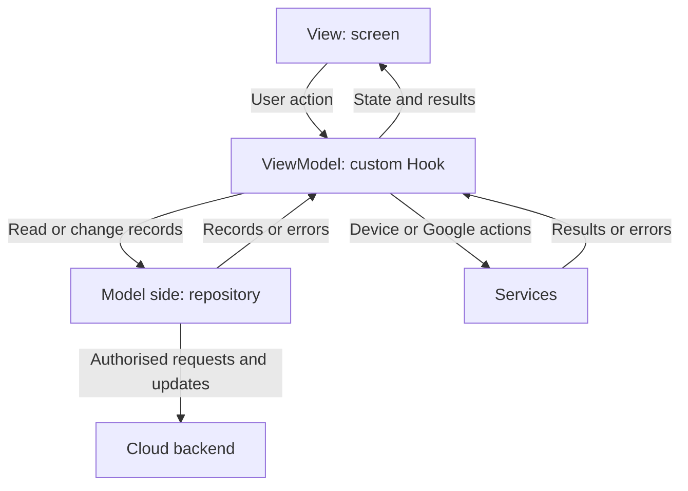

# MediFamily architecture plan

Date: 25 October 2026  
Decision: MVVM, implemented with React Native, Expo, TypeScript and Expo Router.  
Status: architecture design reference; the application code has not been created or reviewed as part of this step.

## 1. What this decision means

MediFamily will separate what users see, how their actions are handled, and how data is stored.

| Part | Responsibility | MediFamily example |
| --- | --- | --- |
| View | Displays information and forms; forwards user actions; shows confirmation dialogs, loading and errors. | Medication list and medication form. |
| ViewModel | Holds screen state and handles actions; validates input; coordinates repositories and services. | Loading a profile's medications and saving a medication form. |
| Model | Represents application data and domain rules. Repositories provide access to that data. | Medication, FamilyProfile and Appointment types; medication repository operations. |

This is our chosen adaptation of MVVM to React. React does not impose this architecture. ViewModels will be purpose-specific custom Hooks, such as `useMedicationsViewModel`. A screen will read the Hook's state and call its actions.

Repositories and services support the three MVVM responsibilities. They keep storage SDKs, Google Calendar and device-specific code separate from screen components.

## 2. Proposed project folders

These are planned application paths, not files claimed to be implemented.

| Planned path | What belongs here |
| --- | --- |
| `src/app/` | Expo Router route files and layouts. Route files render the relevant View and pass route parameters. |
| `src/views/` | Screen components, organised into feature subfolders. |
| `src/viewmodels/` | Custom Hooks containing screen state and actions, organised into the same features. |
| `src/models/` | TypeScript data types and pure domain rules. |
| `src/repositories/` | Data access for accounts, profiles, memberships and healthcare records; attachment upload and deletion coordination. |
| `src/services/` | Notification scheduling, Google Calendar export, camera/file picking, connectivity and local device preferences. |
| `src/context/` | Providers for the signed-in session and selected profile, shared across screens. |
| `src/components/` | Reusable controls, such as form fields, loading/error displays and record cards. |
| `src/config/` | Application configuration and eventual backend client setup. |
| `src/theme/` | Shared colours, spacing and typography. |
| `tests/` | Meaningful tests of domain rules, ViewModel actions and repository behaviour, added as implementation proceeds. |

Example files for one feature:

```text
src/app/profiles/[profileId]/medications/index.tsx
src/app/profiles/[profileId]/medications/new.tsx
src/views/medications/MedicationListScreen.tsx
src/views/medications/MedicationFormScreen.tsx
src/viewmodels/medications/useMedicationsViewModel.ts
src/viewmodels/medications/useMedicationFormViewModel.ts
src/models/Medication.ts
src/repositories/medicationRepository.ts
src/services/notificationService.ts
```

The route files are thin entry points. The View files contain the actual screen UI. All non-route code stays outside `src/app/`, consistent with Expo Router's routing rules.

These examples establish organisation, not the final nine-screen list. Screen allocation is a later step, and route wrappers are not additional screens.

## 3. How an action travels through the app



Example: Daniel adds a medication to his father's profile.

1. The medication form displays the selected profile and accepts the medication details.
2. Save calls the form ViewModel's save action.
3. The ViewModel validates required fields, reminder times and treatment dates. It requests the repository operation and exposes a saving state.
4. The repository sends the profile-scoped request to the backend. The backend verifies current membership and commits the change. For edits/deletions, version checking prevents overwriting a record that changed after it was opened.
5. The repository returns the saved result. The ViewModel exposes success or an actionable error to the View.
6. The reminder service reconciles this device's reminders using its own preferences, notification permission and the saved treatment dates.
7. Other authorised devices receive the saved change and reconcile their own reminders when they receive it.

The cloud result remains authoritative. If the record saves but notification scheduling fails, the app reports that reminder failure without telling the user that the saved medication was lost. No reminder automatically reduces stock or marks a dose as taken.

## 4. Mapping the architecture to FR01-FR09

The names below define responsibilities. A feature can use multiple screen-specific ViewModels; there is no requirement to create one giant Hook per feature.

| Requirement | Views | ViewModels | Models / repositories / services |
| --- | --- | --- | --- |
| FR01 Profiles | Profile selection and profile form | Profiles and profile form Hooks | FamilyProfile; profile repository |
| FR02 Health information | Health information display/form | Health information Hook | HealthInformation; health information repository |
| FR03 Medications | Medication list/form and reminder settings | Medication list/form and reminder settings Hooks | Medication; medication repository; notification and local preference services |
| FR04 Prescriptions | Prescription list/details/form | Prescription Hooks | Prescription; prescription and document repositories; file picker service |
| FR05 Appointments | Appointment list/details/form | Appointment Hooks | Appointment; appointment repository; calendar and notification services |
| FR06 Stock | Stock display/form | Stock Hook | Stock fields associated with Medication; medication repository |
| FR07 Documents | Document list/viewer/details form | Document Hooks | MedicalDocument; document repository; camera/file picker service |
| FR08 Measurements | Measurement list/form | Measurement Hooks | HealthMeasurement; measurement repository |
| FR09 Sharing | Invitation inbox and profile access management | Invitation and sharing Hooks | ProfileMembership and Invitation; sharing repository; session/profile context |

Account authentication is also required infrastructure, even though the coursework excludes it from the functional-requirement and screen minimums. Session context exposes the signed-in account to the rest of the application.

## 5. Where the important rules belong

| Rule | Architectural responsibility |
| --- | --- |
| Each record belongs to a health profile | Model identifiers and profile-scoped repository operations. |
| Only authorised users can read or change cloud records | Backend authorisation. Client UI checks only help users understand available actions. |
| Only the creator can invite, revoke or delete an entire profile | Backend permission checks, surfaced through the sharing/profile ViewModels. |
| Duplicate pending invitations are prevented | Atomic backend validation through the sharing repository. |
| Clinical writes require internet | Repository write policy, backed by the actual server result. A connectivity indicator alone cannot guarantee a request will succeed. |
| Outdated edits/deletions are rejected | Atomic backend version/transaction checks. ViewModels show the reload requirement. |
| Record and profile deletion require confirmation | View displays the confirmation; ViewModel proceeds only after confirmation; repository commits the requested deletion. |
| Prescription/document/medication deletion preserves the required related records | Coordinated backend operations through the relevant repositories, following FR04 and FR07. |
| Stock changes are manual | Medication/stock actions; notification service never modifies the saved quantity. |
| Reminder preferences are independent | Local preferences associated with the signed-in account, profile and device; notification service handles only that device's pending notifications. |
| Access loss cancels local reminders when received | Shared access-change handling and notification reconciliation. |
| Calendar export creates an independent copy | Calendar service makes a one-time Google Calendar API request; it does not implement ongoing synchronisation. |

The backend provider and exact data schema will be selected in the data-storage step. This architecture does not assume Firebase, Supabase or another provider has already been chosen.

## 6. Shared state and live changes

Use React Context providers for the signed-in session and selected profile. Purpose-specific Hooks can read that shared state.

Custom Hooks reuse logic; separate calls do not automatically share the same state. Therefore, two screens must not assume that separate calls to a ViewModel Hook create a shared application store.

Repositories expose current records and, where needed, subscriptions to backend updates. ViewModels subscribe for their active profile and clean up when that profile changes or the screen is no longer active. Profile-scoped state is cleared when access is lost or the account signs out.

A shared access/reminder coordinator under the root providers reconciles reminders when medication, appointment or access changes are received. Reminder updates must not depend solely on whether a particular record's screen is open.

The selected profile in Context is a navigation convenience. It never replaces backend permission checks.

## 7. Why this fits MediFamily

- The same healthcare record can be accessed by several family accounts. Keeping data access in repositories gives screens a consistent way to read and change it.
- Medication reminders, attachments and Google Calendar exports involve different external systems. Separate services give each integration a clear place.
- Each of the three students can work on feature screens and their ViewModels while sharing the same models and interfaces.
- Pure rules and ViewModel actions can be tested without rendering every screen.
- The Phase 1 UI can use clearly labelled demonstration data behind the repository boundary. In Phase 2, the cloud implementation can replace that adapter while the screen-facing contract stays stable.

Demonstration data is only a prototype aid. It does not satisfy persistent-storage, authorisation, synchronisation or working-reminder requirements.

## 8. What completes the architecture marking criteria

| Criterion | Available marks | Status after this design step |
| --- | --- | --- |
| Select an architecture | 2 | MVVM selected. |
| Explain the reasoning | 2 | Project-specific reasons defined above for the team to understand and explain in their own words. |
| Apply it in the project structure | 2 | Structure designed; still requires application code that follows these responsibilities. |

An empty folder structure alone does not demonstrate the implemented architecture. During UI implementation, include a real example of a View calling its ViewModel and the ViewModel using its data-access boundary.

This reference records engineering decisions. The assessed report must be written by the students, as required by the module brief.

## 9. Next step

Define the data items, types, relationships, cloud persistence approach and preliminary data model. Then finalise the nine-screen plan and team allocation before implementing the UI.

## Sources checked

- Module Phase 1 requirements: https://mobdev.vercel.app/coursework/cw-01
- Module project technical requirements: https://mobdev.vercel.app/project
- React custom Hooks: https://react.dev/learn/reusing-logic-with-custom-hooks
- Expo Router routing conventions: https://docs.expo.dev/router/basics/core-concepts/
- User-supplied official coursework Word brief and final FR01-FR09 in this conversation.

MVVM and the folder layout are the architecture selected for MediFamily. React and Expo documentation support the underlying Hook and routing mechanisms; they do not prescribe this exact MVVM layout.

